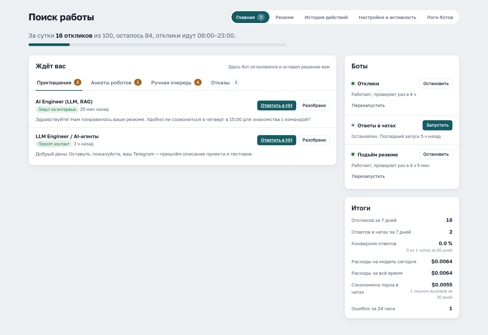
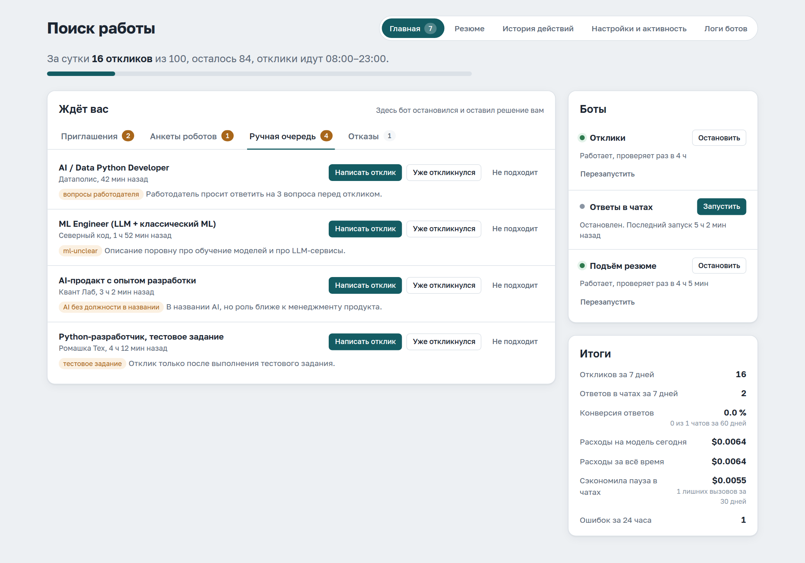
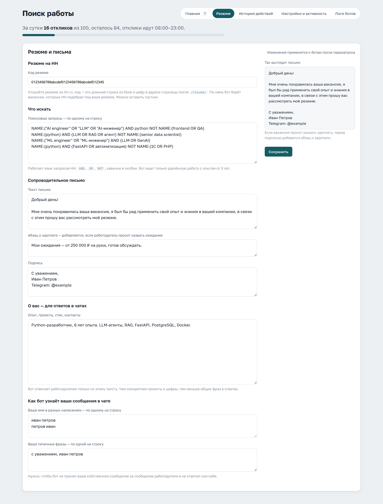
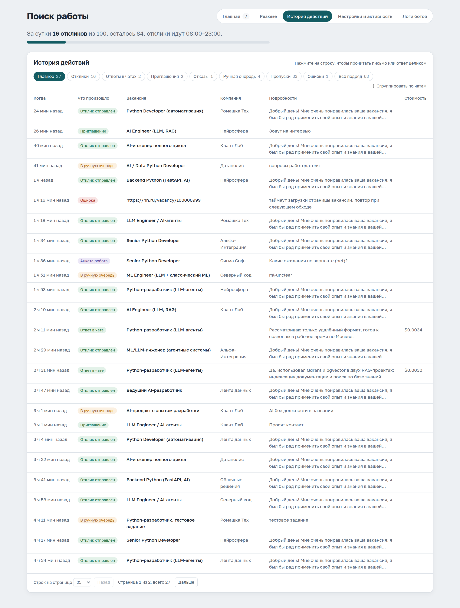
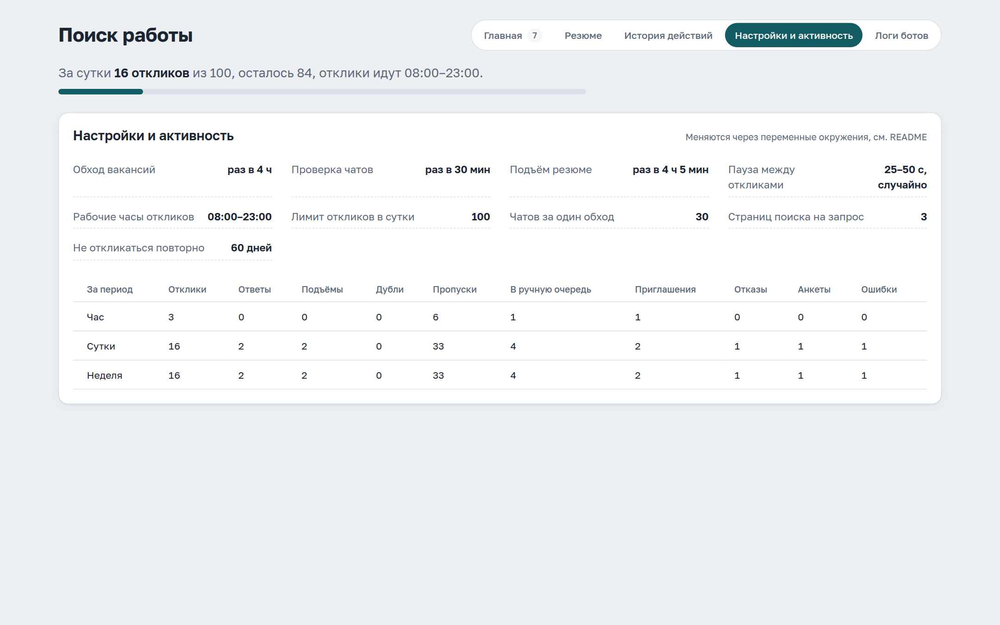
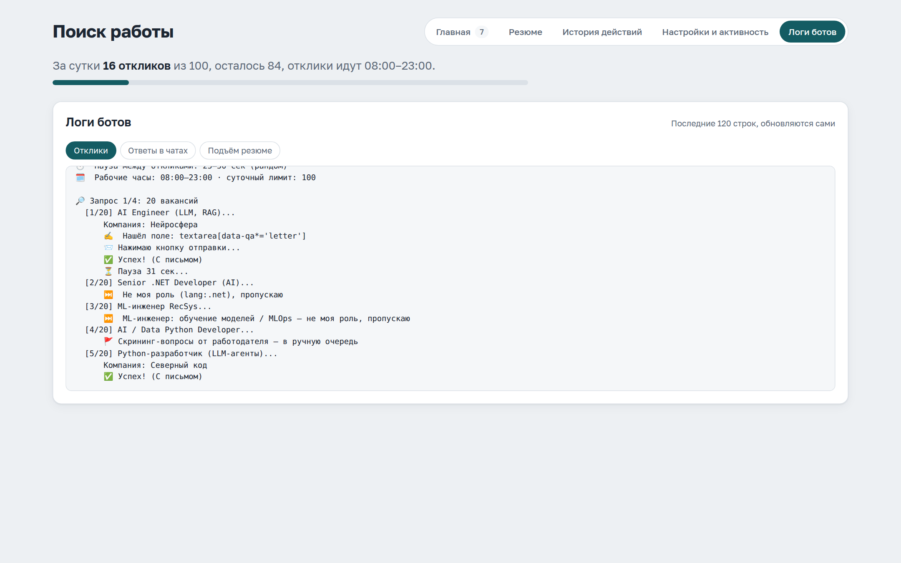
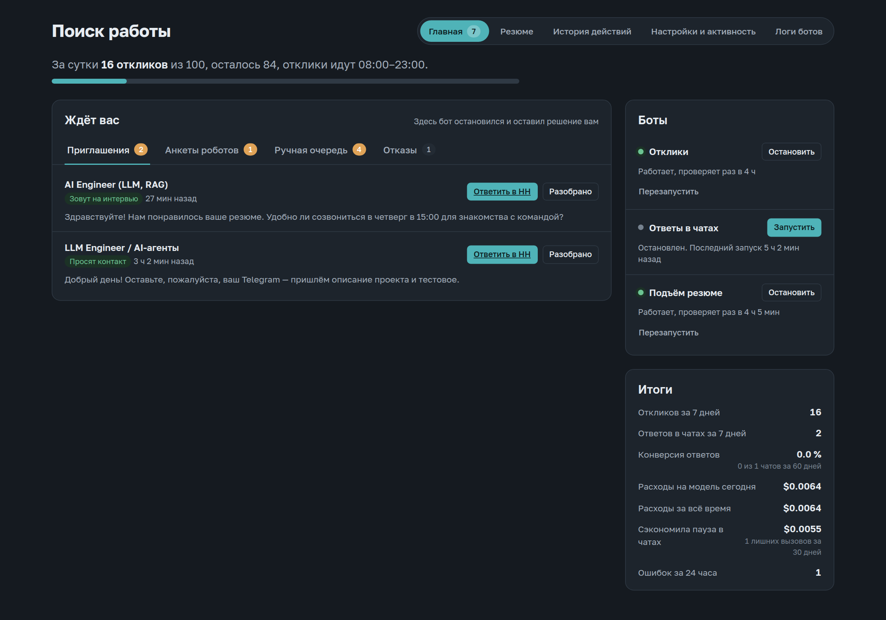
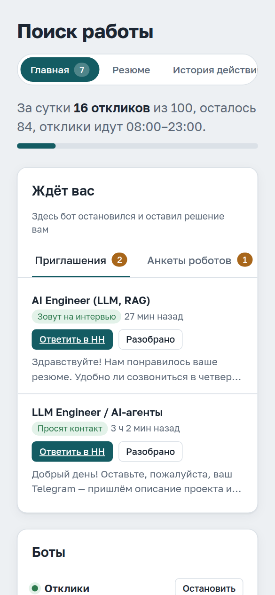

# hh-auto-apply

> Автоматизация поиска работы на HH.ru: поиск удалённых вакансий, отсев неподходящих, отклики с сопроводительным письмом, ответы работодателям в чате и подъём резюме. Всё управляется из локального веб-дашборда, личные данные не попадают в код.

> [!NOTE]
> **Ветка `qwen-branch` — запасной вариант на OpenRouter.** Ответы в чате генерируются через OpenRouter (OpenAI-совместимый API): нужны `OPENROUTER_API_KEY` в `.env` и пакет `openai` (`pip install openai`), модель — `OPENROUTER_MODEL` (по умолчанию `google/gemma-4-31b-it:free`). Остальная документация ниже описывает основную версию на Claude из ветки `main`.

[](https://www.python.org/)
[](LICENSE)
[](https://www.anthropic.com/claude)
[](https://playwright.dev/)
[](https://fastapi.tiangolo.com/)
[](https://github.com/astral-sh/ruff)
[](https://github.com/semernyakov/hh-auto-apply/commits/main)

> [!CAUTION]
> **Отказ от ответственности.** Проект распространяется «как есть». Использование может нарушать [Условия использования HH.ru](https://hh.ru/article/agreement_paid_services) и привести к **блокировке аккаунта**, финансовым потерям и иным последствиям — все риски на пользователе. **Авторы не несут ответственности** ни за какие прямые или косвенные убытки, связанные с использованием Проекта.
>
> Полный текст: [**DISCLAIMER.md**](DISCLAIMER.md). Запуская проект, вы безоговорочно с ним соглашаетесь.

> [!IMPORTANT]
> **Лицензия — проприетарная, все права защищены** (см. [LICENSE](LICENSE)). Исходный код открыт для ознакомления; использование, копирование, изменение и распространение — только с письменного разрешения правообладателя.

---

## Скриншоты

> Все скриншоты сделаны на **демо-данных**: вакансии, компании, переписка и профиль вымышлены.

| Главная: «Ждёт вас» и боты | Ручная очередь |
|---|---|
|  |  |
| Всё, где бот остановился и оставил решение вам: приглашения, анкеты роботов, ручная очередь, отказы. Справа — состояние ботов (старт/стоп) и итоги за неделю. | Пограничные вакансии с причиной: скрининг-вопросы, неясная ML-роль, AI без должности, тестовое задание. Отклик в один клик, «уже откликнулся» или «не подходит». |

| Резюме и письма | История действий |
|---|---|
|  |  |
| Профиль соискателя без правки кода: код резюме, поисковые запросы, текст письма с предпросмотром, абзац о зарплате, подпись, описание опыта для ответов в чате. | Все действия ботов с фильтрами (отклики, ответы, пропуски, ошибки…), группировкой по чатам и стоимостью вызовов модели. Клик по строке — полный текст письма или ответа. |

| Настройки и активность | Логи ботов |
|---|---|
|  |  |
| Текущие интервалы, рабочие часы, лимиты и сводка активности за час, сутки и неделю. | Последние строки логов каждого бота, обновляются сами — видно, что бот делает прямо сейчас и почему пропустил вакансию. |

| Тёмная тема | Телефон |
|---|---|
|  |  |
| Тема переключается по системной настройке. | Вёрстка адаптирована под узкие экраны. |

## Что умеет

- 🔍 **Поиск** удалённых вакансий по составным запросам языка HH (`AND` / `OR` / `NOT`, `NAME:(…)`) + выдача HH «по резюме». Фильтры `schedule=remote` и опыт от 3 лет.
- 🎯 **Отсев по названию** (`title_route`): своя роль (AI/LLM + должность, Python) — в отклик; чужая роль (DevOps, QA, frontend, аналитики, DS…) — в пропуск; чужой основной язык без Python (.NET, C#, Java, Go, PHP, 1С…) — в пропуск; пограничные случаи — в ручную очередь.
- 🧠 **Разбор ML-вакансий по описанию** (`classify_ml_vacancy`): отделяет AI-инженера полного цикла от DS и инженера по обучению моделей / MLOps / рекомендательным системам. Ничья — в ручную очередь.
- ✍️ **Сопроводительное письмо** по шаблону из раздела «Резюме» (+ абзац о зарплате, если вакансия просит её назвать). Отклик засчитывается, только когда HH его подтвердил.
- 💬 **Ответы в чате** работодателю через Claude Haiku 4.5 с контекстом всей переписки и промптом против «AI-штампов». Prompt caching снижает стоимость.
- 🤖 **Анкеты автоботов** (`Робот-рекрутёр`, серии однотипных вопросов) не отвечаются моделью, а уходят в отдельную очередь — ответ пишете вы, бот может отправить его из дашборда.
- 🎉 **Приглашения** (интервью, запрос контакта, «на рассмотрении») — отдельная очередь + опционально Telegram-уведомление.
- 🛡️ **Антибан**: рабочие часы, суточный лимит, случайные паузы и интервалы, остановка прогона при капче, cooldown в чатах, дедупликация откликов (по `vacancy_id` и по паре работодатель + должность).
- 🔐 **Проверка входа**: перед обходом боты проверяют сессию HH и останавливаются с понятной ошибкой «сессия HH истекла», а не работают гостем.
- ⬆️ **Подъём резюме** по таймеру.
- 📊 **Веб-дашборд** (Главная, Резюме, История, Настройки, Логи): светлая и тёмная тема, адаптивная вёрстка, управление ботами кнопками.
- 🔒 **Личные данные вне кода**: профиль — в `profile.json` (права 600, в `.gitignore`), ключи — в `.env`.
- ✅ **Тесты**: `python -m unittest tests.test_detectors` — детекторы ролей, анкет, отказов и приглашений без внешних зависимостей.

---

## Quick start

```bash
git clone https://github.com/semernyakov/hh-auto-apply.git
cd hh-auto-apply

# 1. Виртуальное окружение + зависимости
python3 -m venv .venv
.venv/bin/pip install playwright python-dotenv anthropic fastapi uvicorn
.venv/bin/python -m playwright install chromium   # или будет использован системный chromium

# 2. Ключ Anthropic — нужен только для ответов в чате
echo 'ANTHROPIC_API_KEY=sk-ant-...' >> .env

# 3. Вход в HH.ru: откроется браузер, войдите — сессия сохранится сама
.venv/bin/python hh_login.py

# 4. Дашборд
make start
# → http://127.0.0.1:8765: раздел «Резюме» — заполнить профиль, «Главная» — запустить ботов
```

Перед первым боевым запуском проверьте отсев без откликов: `.venv/bin/python auto_apply_template.py --dry-run`.

Подробный гайд: [SETUP_GUIDE.md](SETUP_GUIDE.md).

---

## Конфигурация

### Профиль — раздел «Резюме» в дашборде

Хранится в `profile.json` (права 600, в `.gitignore`). Пока файла нет, читается `profile.py` (шаблон — `profile.example.py`). После сохранения перезапустите ботов — профиль читается при старте.

| Поле | Назначение |
|---|---|
| `resume_id` | Код резюме из адреса `hh.ru/resume/<код>` — для выдачи «по резюме» (`HH_RESUME_ID` в `.env` перекрывает) |
| `search_queries` | Поисковые запросы, по одному на строку |
| `letter_body` | Текст сопроводительного письма |
| `salary_addendum` | Абзац о зарплате — добавляется, если вакансия просит назвать ожидания |
| `letter_signature` | Подпись |
| `my_profile` | Опыт, проекты, стек — контекст для ответов в чате |
| `self_name_markers` | Ваше имя в разных написаниях — чтобы бот узнавал свои сообщения в чате |
| `own_text_markers` | Ваши типичные фразы — запасной способ узнать свои сообщения |

### Переменные окружения (`.env`)

| Переменная | По умолчанию | Что делает |
|---|---|---|
| `ANTHROPIC_API_KEY` | — | Ключ Claude API, нужен только боту ответов в чате |
| `HH_RESUME_ID` | — | Код резюме (перекрывает `resume_id` из профиля); несколько — через запятую, выдача «по резюме» смотрится по каждому |
| `HH_HEADLESS` | `1` (через Makefile) | `1` — браузер без окна |
| `HH_PROXY` | — | Прокси для браузера (например `socks5://127.0.0.1:2080`) |
| `PLAYWRIGHT_CHROMIUM_EXECUTABLE_PATH` | — | Свой путь к Chromium |
| `HH_APPLY_INTERVAL_SEC` / `HH_APPLY_INTERVAL_JITTER` | `14400` / `0.25` | Интервал обхода вакансий (4 ч) и его случайный разброс |
| `HH_WATCH_INTERVAL_SEC` / `HH_WATCH_INTERVAL_JITTER` | `1800` / `0.2` | Интервал проверки чатов |
| `HH_BOOST_INTERVAL_SEC` | `14700` | Интервал подъёма резюме |
| `HH_DELAY_APPLY_MIN` / `HH_DELAY_APPLY_MAX` | `25` / `50` | Пауза между откликами, сек |
| `HH_DELAY_CHAT_MIN` / `HH_DELAY_CHAT_MAX` | `20` / `40` | Пауза между чатами, сек |
| `HH_WORK_HOUR_START` / `HH_WORK_HOUR_END` | `8` / `23` | Рабочие часы откликов |
| `HH_MAX_APPLIES_PER_DAY` | `100` | Суточный лимит откликов |
| `HH_MAX_PAGES` | `3` | Страниц выдачи на один запрос |
| `HH_SKIP_ON_SITE` | `1` | Офисные вакансии — сразу в пропуск (`0` — в ручную очередь) |
| `HH_ML_CLASSIFY` | `1` | Разбор ML-вакансий по описанию (`0` — выключить) |
| `HH_PENDING_MAX_AGE_DAYS` | `14` | Сколько дней вакансия висит в ручной очереди |
| `HH_REPLY_COOLDOWN_SEC` | `21600` | Не вызывать модель повторно, пока работодатель не написал новое |
| `HH_ALL_CHATS` | — | `1` — обходить все чаты, а не только непрочитанные (отладка) |
| `HH_DASHBOARD_HOST` / `HH_DASHBOARD_PORT` | `127.0.0.1` / `8765` | Адрес дашборда |
| `HH_DEV_RELOAD` | — | `1` — `uvicorn --reload` при разработке |
| `TELEGRAM_BOT_TOKEN` / `TELEGRAM_CHAT_ID` | — | Telegram-уведомления о приглашениях и анкетах ([@BotFather](https://t.me/BotFather), [@userinfobot](https://t.me/userinfobot)) |
| `TELEGRAM_TIMEOUT_SEC` | `5` | Таймаут запросов к Telegram API |

---

## Архитектура

```
┌──────────────┐  HTTP  ┌──────────────────────────────┐
│  Dashboard   │ ────→ │ /api/{status,events,profile,…}│
│ dashboard.   │ ←──── │ FastAPI (dashboard.py)        │
│    html      │        └──────┬────────────────────────┘
└──────────────┘               │ subprocess.Popen --watch
        ┌──────────────────────┼──────────────────────┐
        ↓                      ↓                      ↓
  ┌────────────┐        ┌────────────┐        ┌────────────┐
  │  apply     │        │  reply     │        │  boost     │
  │ поиск,     │        │ чаты HH    │        │ подъём     │
  │ отсев,     │        │ + Claude   │        │ резюме     │
  │ отклик     │        │            │        │            │
  └─────┬──────┘        └─────┬──────┘        └─────┬──────┘
        └──────────────┬──────┴──────────────┬──────┘
                       ↓ Playwright          ↓ HTTPS
                  ┌────────────┐       ┌────────────────┐
                  │  HH.ru     │       │ Anthropic API  │
                  │ (Chromium) │       │ (Haiku 4.5)    │
                  └────────────┘       └────────────────┘

  metrics → SQLite (~/.n8n-files/hh_metrics.sqlite)
  профиль → profile.json · сессия HH → ~/.n8n-files/hh_session.json
```

Три независимых бота и дашборд. Все пишут в общую SQLite-базу метрик и истории; сессию HH читают все, обновляет её только `hh_login.py`. Дашборд запускается через `make start` в фоне (`nohup`), боты — его дочерние процессы в отдельных сеансах: закрытие терминала их не останавливает.

---

## Очередь анкет от автоботов

HH-рекрутёры всё чаще присылают **скрининг-анкеты** автоматическим ботом — пять-семь однотипных вопросов подряд. Ответ модели на такую анкету уходит работодателю, и **отозвать его нельзя**.

Такие диалоги определяются двумя способами:
- **по автору** — роль пузыря содержит `робот / hr-бот / bot / автоответ / чат-бот` и т.п.;
- **по серии** — последние ≥2 входящих сообщения подряд начинаются с шаблонных зачинов («был ли у вас опыт», «есть ли», «сколько лет опыта»…).

Модель в этих чатах не вызывается: анкета уходит во вкладку «Анкеты роботов» (и в Telegram, если настроен). Ответ пишете вы: «Отправить ответ» — бот отправит его в чат под вашей сессией, «Ответил сам в HH» — просто убрать из очереди.

## Telegram-уведомления

Модуль `notify.py` шлёт сообщение при приглашении, запросе контакта, «на рассмотрении» и при первой анкете автобота в новом чате. Без `TELEGRAM_BOT_TOKEN` / `TELEGRAM_CHAT_ID` модуль ничего не делает.

```bash
TELEGRAM_BOT_TOKEN=... TELEGRAM_CHAT_ID=... .venv/bin/python notify.py
```

## Тесты

```bash
.venv/bin/python -m unittest tests.test_detectors -v
```

Unit-тесты детекторов ролей в чате (`_detect_role`, `_text_is_own`), анкет автоботов (`is_robot_questionnaire`), отказов (`is_rejection`) и приглашений (`detect_positive_signal`). Внешние зависимости замоканы в `tests/conftest.py`, совместимы с `pytest`.

## Миграция ролей в истории чатов

Если вы обновились с версии до `db56e48` (роль по CSS-классу пузыря), часть ваших прошлых сообщений в истории могла быть приписана работодателю:

```bash
.venv/bin/python migrate_history_roles.py --days 60            # dry-run, превью
.venv/bin/python migrate_history_roles.py --days 60 --apply    # запись — сначала бэкап SQLite!
```

---

## Что этот проект НЕ делает

- Не обходит капчу — при капче прогон останавливается.
- Не парсит закрытые и премиум-вакансии.
- Не подделывает браузерный fingerprint (canvas, WebGL и т.п.) — только паузы, рабочие часы и лимиты.
- Не работает как массовая рассылка: обход раз в 4 часа, 25–50 секунд между откликами, лимит 100 в сутки.
- Не собирает данные сверх того, что HH показывает вам после входа.

---

## Приватность

В репозитории **нет**: ФИО, контактов, проектов из биографии, работодателей, зарплатных ожиданий, API-ключей, кода резюме. Всё это — только локально: профиль в `profile.json` / `profile.py`, ключи в `.env`, сессия HH и база метрик в `~/.n8n-files/` (всё вне git).

---

## Лицензия

**Проприетарная, все права защищены** — см. [LICENSE](LICENSE). Код можно просматривать на GitHub; любое другое использование, копирование, изменение и распространение, в том числе коммерческое, — только с письменного разрешения правообладателя. По вопросам лицензирования — через [Issues](https://github.com/semernyakov/hh-auto-apply/issues).

Версии, опубликованные до 26.10.2026 включительно (до коммита `a8c4b49`), распространялись по лицензии MIT и остаются под ней.

## Обратная связь и безопасность

Сообщения об ошибках и предложения — через Issues, правила — в [CONTRIBUTING.md](CONTRIBUTING.md). Утечку данных или уязвимость — не публикуйте в issue, а сообщите через GitHub Security Advisories: [SECURITY.md](SECURITY.md).
